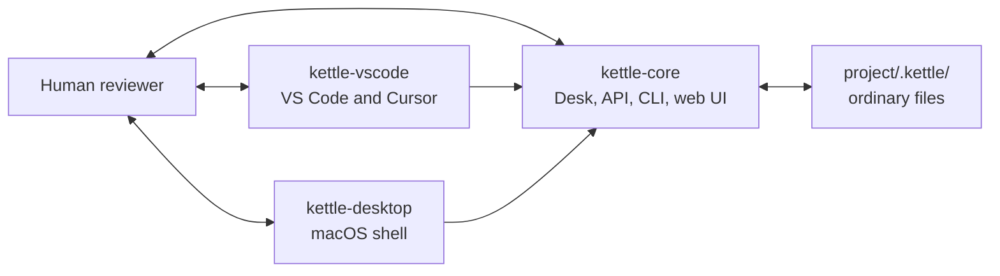

# Kettle family architecture

Kettle is one product with separate release units. Coherence comes from one
core authority, explicit contracts, and compatibility checks rather than a
monorepo or duplicated behavior.

## Repository ownership

| Repository | Owns | Does not own |
|---|---|---|
| `kettle` | Public story, family map, roadmap, release definition | Runtime or adapter code |
| `kettle-core` | Product semantics, Desk format and migrations, localhost API, curator runtime, CLI, kits, reference web UI | Editor or Electron lifecycle |
| `kettle-vscode` | VS Code/Cursor activation, commands, views, packaging | Desk migrations or product semantics |
| `kettle-desktop` | Electron lifecycle, bundled-core provenance, native packaging | A separate frontend or product rules |

The CLI is a first-class viewport distributed by `kettle-core`. Future adapters
should get repositories only when they have a concrete host workflow, an owner,
and a release path. A later MCP bridge, if any, is a handoff kit — not a
sitting and not a CLI replacement. See [MCP bridge](./mcp-bridge.md).

## CLI and plugin chat

CLI and plugin (VS Code / Cursor) agent chat are **paired craft**. They are
two viewports on one Desk stream, not a shell sidecar plus a separate editor
product. Fixes that improve honesty — protocol, copy, status, errors — belong
in core first so both surfaces get better. Adapters stay thin: they render the
spine; they do not invent CLI-only rituals the Desk cannot express.

That pairing is the same idea as the first-sitting rule that shell and web
should describe the same Desk. Workshop notes may live in gitignored
`.local/agent-surfaces.md`; the public inventory of remaining gaps is
[`docs/reference/chat-signature-inventory.md`](../reference/chat-signature-inventory.md).

## Sources of truth

| Fact | Authority |
|---|---|
| Product story and family sequence | This repository |
| Core behavior and invariants | `kettle-core/ARCHITECTURE.md` |
| HTTP and streaming behavior | `kettle-core/API.md` and contract tests |
| CLI × plugin chat gaps (protocol, copy, errors) | This repo: [`docs/reference/chat-signature-inventory.md`](../reference/chat-signature-inventory.md) |
| Core, API, and Desk-schema versions | `kettle-core/kettle_contract.py` |
| Contracts supported by an adapter | That adapter's `kettle-compatibility.json` |
| Host lifecycle and packaging | The relevant adapter repository |

Core never imports an adapter. A cross-repository feature lands in core first,
with a backward-compatible contract and tests, then in affected adapters.
Package versions advance independently.

## Durable state

New projects use an ordinary `.kettle/` directory inside the project. During
the Setsweep compatibility window, core and adapters prefer `.kettle/` and fall
back to an existing `.setsweep/` Desk. They do not create two writable Desks
for one project.

API and Desk-schema integers describe behavioral contracts. A brand rename does
not advance them. A breaking change requires a version increment, tests,
adapter manifest updates, and a migration story.

## Network and trust boundary

Core is designed for one local user and binds to `127.0.0.1`. Registered
project roots fence file operations. Provider credentials remain with provider
CLIs. Remote and multi-user serving are out of scope until authentication,
tenant isolation, and session ownership are designed together. That is a
separate threat model from a later local MCP handoff
([MCP bridge](./mcp-bridge.md)).
